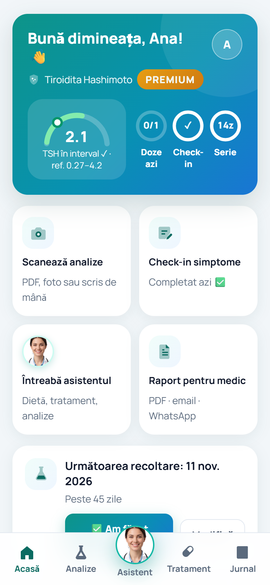
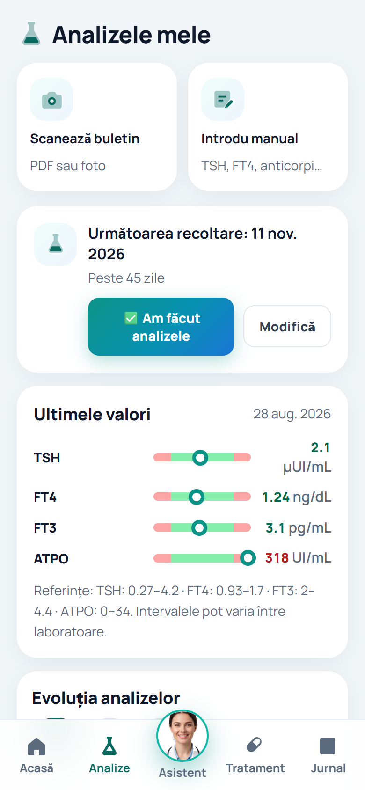
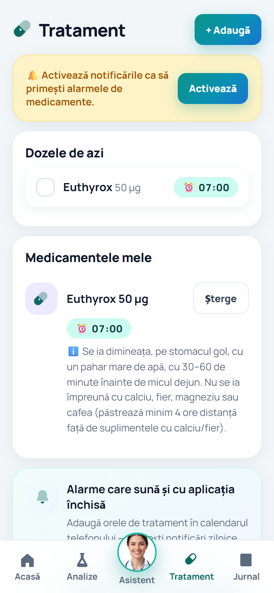
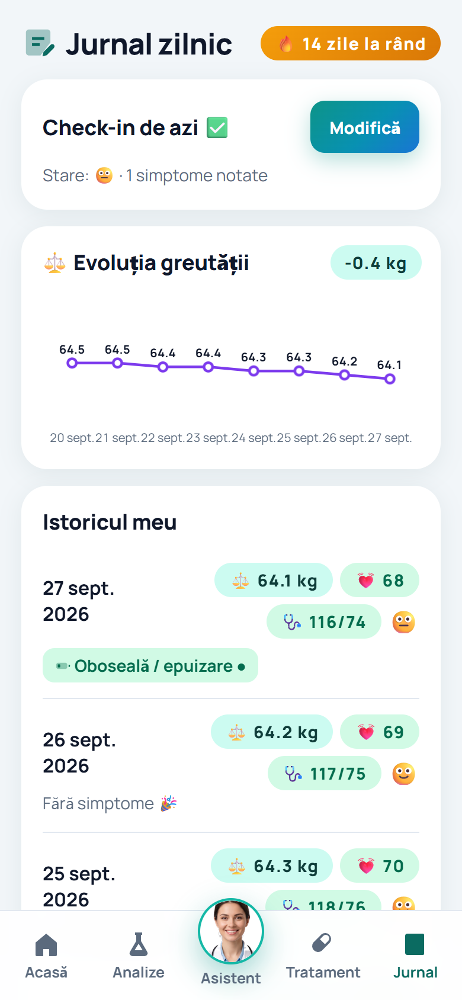

# TiroCare — case study

**A personal health companion for people living with thyroid conditions, built for Romanian patients.**
Lab results, treatment, symptoms and a report for the doctor in one app, with an optional AI assistant
designed around the safety rules a health product needs.

**[Try the web app](https://tirocareromania.netlify.app)** · Android app prepared for Google Play

  
  
  
  

Screenshots use a fictitious demo profile. The app's interface is in Romanian.

> TiroCare's source code is private because it is a commercial product. This page explains what it does and
> how it is built; I'm happy to walk through the code in an interview.
>
> TiroCare provides educational information and tracking tools. It is not a medical device and does not
> diagnose, treat, cure or prevent any condition.

---

## At a glance

| | |
|---|---|
| **Platforms** | Web app (Netlify) and Android (Capacitor) from one codebase |
| **Stack** | JavaScript · HTML/CSS · Capacitor · Netlify Functions · Google Gemini · Tesseract · pdf.js |
| **Language** | Romanian interface and content |
| **Accounts** | None. The journal, lab results and notes are stored on the phone |
| **AI** | Optional, off by default, enabled with explicit consent and switchable off at any time |

## What it does

- **Adapts to the condition.** Onboarding tailors advice, diet and treatment content to Hashimoto's,
  hypothyroidism, hyperthyroidism, Graves' disease, post-thyroidectomy or nodules.
- **Lab results without typing.** Import a report as a PDF or a photo, printed or handwritten; TSH, FT4, FT3,
  ATPO, TRAb and other values are read automatically, confirmed by the user, checked against reference ranges (adjusted during
  pregnancy) and charted over time.
- **Treatment reminders.** Daily medication alarms, a reminder for the retest date the doctor set, and export
  to the phone's calendar so reminders fire even when the app is closed.
- **Daily journal.** Symptoms, weight, pulse and blood pressure, building a history for the next appointment.
- **Report for the doctor.** A complete PDF (results, symptoms, treatment) to email, share or print.

## How it's built

| Part | Where it runs | What it does |
|---|---|---|
| App (journal, results, reminders, reports) | On the phone | All tracking; data kept in local storage, no account |
| OCR (Tesseract, pdf.js) | On the phone | Reads lab reports; engine and language data are self-hosted, so no third party sees the document |
| `chat` and `scan` functions | Netlify Functions | Called **only after AI consent**; they hold the API key and call Google Gemini |
| `report` function | Netlify Functions | Lets users flag an AI answer from inside the app |

The API key never reaches the device: the app talks only to its own serverless functions, which call the model.

## Engineering highlights

**Safety layers around the AI.** In a health app, what the assistant must *not* do matters as much as what it
does:

1. **Red-flag check first.** Emergency symptoms are detected before any model call. In an emergency, the AI
   is never asked; the user is sent to urgent care.
2. **Deterministic dose warning.** Questions about dosage get a fixed, code-generated warning up front, and
   the assistant refers the user to their endocrinologist instead of suggesting doses.
3. **Plausibility checks on scanned values.** Numbers read from a document pass physiological range checks and
   a confirmation form before they are saved.
4. **Graceful fallback.** If the AI service is unavailable, a local assistant answers and the question isn't lost.
5. **Minimal data.** The patient's name is never sent to the model.
6. **Explicit consent.** Every AI feature sits behind an opt-in consent screen and can be switched off at any time.

**Private OCR by default.** Reading a lab report happens on the phone, with Tesseract and pdf.js served by the
app itself rather than a CDN. The more accurate AI scan of photos is used only when the user has opted in.

**In-app reporting of AI answers.** Users can flag any AI response from inside the app, a Google Play
requirement for apps with generative AI, implemented as its own serverless endpoint.

**Resilient model selection.** Hard-coded model names broke at the first real test, so the backend asks the
provider which models are available, picks a suitable one and remembers what worked.

**Honest store listing and privacy.** The Play listing, Data Safety form and public
[privacy policy](https://tirocareromania.netlify.app/confidentialitate.html) were audited against what the app
actually does. For example, "all data stays on your phone" was corrected once the optional AI assistant began
sending questions and photos to Google, and wording that could read as clinical decision support was removed.

**Notifications that work.** Web notifications don't fire when the app is closed, so reminders can be
exported to the phone's calendar as `.ics` events.

---

Made by **Adrian Iulian Antal** · [GitHub](https://github.com/portalstudiodesign) ·
[LinkedIn](https://www.linkedin.com/in/antal-adrian-iulian/)
